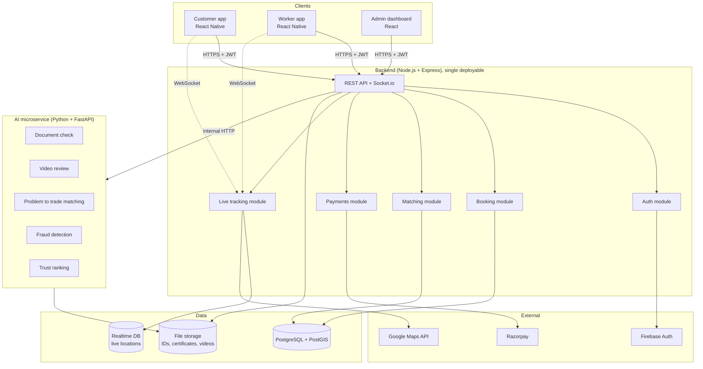

# SkillSetu: Architecture

## 1. Goals that drive the design
1. **Trust first**: identity, proof of skill and a fair record are the product. Every component serves one of them.
2. **Human in the loop**: AI assists, an admin decides. AI failure must never take the platform down.
3. **Four people, one year**: simple, modular, independently buildable parts with clear contracts between them.

## 2. System diagram

**Key rule:** clients talk only to the backend. The backend is the only caller of the AI service.

## 3. Architectural decisions

| # | Decision | Why |
|---|---|---|
| 1 | **Monorepo** (apps + services in one repo) | One PR can change API + app together; one CI; easy for 4 people |
| 2 | **Modular monolith** backend (modules, not microservices) | Microservices add ops overhead a 4-person team doesn't need |
| 3 | **AI as a separate Python service** | Different language/deps/scaling; can fail without killing the platform |
| 4 | **Contract-first APIs** (`docs/api/openapi.yaml`) | Mobile, backend and AI work in parallel against a fixed contract |
| 5 | **Fallback for every AI module** | Slide 9 promise: if a model is down, manual review continues |
| 6 | **Explainable scores** (`score` + `reasons` + `model_version`) | Admin and worker can see *why*; needed for trust-score fairness |
| 7 | **One mobile codebase, two role navigators** | Customer and worker apps share auth, maps, UI kit |
| 8 | **Docker everywhere** | "Works on my machine" disappears; CI builds the same image as prod |

## 4. Core flows

**Worker verification:** Worker uploads ID, certificates, video -> backend stores files, creates `verification_case` (status `pending`) -> backend calls AI `document-check` + `video-review` -> results saved with scores -> low-risk auto-queued as "likely OK", doubtful flagged -> **admin approves/rejects** -> worker goes online.
If AI times out: case is created with status `needs_manual_review`.

**Customer booking:** Customer enters text/voice -> backend calls `problem-match` -> trade + urgency -> Matching module queries PostGIS for verified, online workers nearby -> ranks by skill fit x trust score (`trust-rank`) -> customer books -> Socket.io live tracking -> Razorpay payment -> rating updates trust score.
If AI times out: customer picks the trade from a list; ranking falls back to rating + distance.

## 5. Data model (starting point)
`users` (id, role, firebase_uid) · `worker_profiles` (user_id, trades[], location geography, is_online, trust_score) · `documents` (worker_id, type, file_url, ai_score, ai_reasons) · `verification_cases` (worker_id, status, reviewer_id, decision_note) · `bookings` (customer_id, worker_id, trade, urgency, status, price, location geography) · `payments` · `reviews` · `fraud_flags` · `disputes`.

## 6. AI module contract
All modules return `{ "score": float, "reasons": [string], "model_version": string }`. Each is built in two steps: **(1) rule-based baseline + tests, (2) trained model**. This guarantees a working demo even if a model underperforms.

## 7. Environments

| Env | Purpose | Deployed from |
|---|---|---|
| local | Developer laptop, `docker compose up` | your branch |
| CI | Automatic checks on every PR | PR branch |
| staging | Team + guide demo | every merge to `main` |
| production (optional) | Final demo | tagged release `vX.Y.Z`, manual approval |

## 8. Security basics
- JWT/Firebase auth; role checks (`customer` / `worker` / `admin`) on every route.
- Uploaded IDs are sensitive: private storage bucket, signed URLs, never in git, never in LLM prompts.
- Secrets only in env vars / GitHub Secrets. `gitleaks` blocks leaked keys in CI.
- Rate-limit booking and upload endpoints (also feeds fraud detection).

## 9. Testing strategy
Unit tests per module · API contract tests · AI module tests on a small labelled sample set · one end-to-end demo script (seeded workers + bookings in one locality) used for the final demo.
